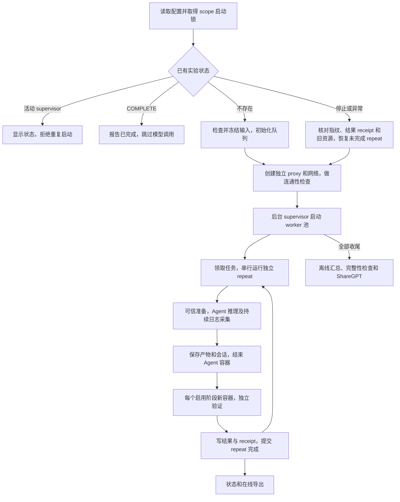

# CyberGym-E2E 本地外壳：完整功能与实现方案

日期：2026-10-09。状态：**已实现**（代码、模拟测试与文档见本目录；实现修订记录见文末第 22 节）。本文是官方数据集批量评测控制器的功能规格，根据本机 E2E、ExploitGym、CyberGym 和 capture proxy 源码，以及对当前评测进程的只读检查编写。范围包括调度、容器生命周期、数据管理、日志采集和结果导出。

## 1. 已确认的需求和默认值

外壳参考 `/data/exploitgym/scripts/local_full_image`，保留数据冻结、任务池、后台 supervisor、资源 watchdog、网络隔离、capture、轨迹重建、完整性分析、ShareGPT、状态面板和精确停止清理；增加同 EXP 自动续跑与可配置阶段判定。

用户已确认：

- Claude Code 固定为官方 E2E 使用的 **2.1.91**，不是 2.1.89。
- `MODE` 放进 config，默认 `e2e`，支持 `patch-only`。
- 可配置启用哪些 S 阶段，以及哪些阶段共同构成成功条件；成功条件必须是启用阶段的非空子集。
- 所有启用阶段独立执行，前一阶段失败也继续后面的阶段；每阶段使用全新容器。
- 保留每个阶段的结果，支持以后重新分组而不调用模型。
- 数据和输出放在 `/data/cybergym-e2e/output` 下；用户稍后下载官方数据集。
- 容器 CPU 为 2；首轮其他资源参数由实现方给出合理估计。
- 保留网络失败、丢包、上游不完整响应的重试，以及 Docker 并发启动超时恢复。
- 手动 stop 后，不改 config，再运行同一个 `run_all.sh` 即可接续：已完成 repeat 跳过，被中断 repeat 重新运行。
- config 全部中文注释，可修改参数集中在最前面，派生路径与内部实现放在后面。

建议首轮配置：8 workers、每任务 2 次独立 repeat、`glm53`、`high`、Agent 上限 604800 秒。Agent 内存 12 GiB，验证容器内存 16 GiB，CPU 均为 2，PID 上限 2048。支持先用一个任务和一次 repeat 验收，随后按主机实际预算提高 workers。

## 2. 已核实的现状与问题

| 现状 | 证据和含义 | 必须处理的内容 |
|---|---|---|
| E2E CC 安装固定 2.1.91 | `scripts/run_agent.py` 的 npm 安装命令 | 保留该版本，启动后再次核验实际版本，记录版本与工具包哈希 |
| CyberGym 历史日志为 2.1.89 | 本机三个已有 console.log 的 system init 事件 | 只证明已有运行，不宣称当前镜像再次运行必定相同 |
| 当前 ExploitGym 工具包为 2.1.119 | 活动 Agent 将 `/data/exploitgym/data/runtime` 只读挂载到 `/data`；对应 package.json 为 2.1.119 | 不借用或修改这一工具目录，新 E2E 独立准备 2.1.91 |
| Anthropic 模式没有透传 base URL | E2E `run_agent()` 只放入 key 和 model | 显式把 capture 地址传入容器；统一所有模型别名，避免小模型请求走其他地址 |
| CC 日志只在结束后保存 | `_execute_claude_code()` 缓冲 stdout/stderr，结束后写 attempt 日志 | 改为持续落盘，保留崩溃／手动停止前的输出 |
| 未导出 Claude session JSONL | E2E 只保存 console 输出，未导出 projects 会话目录 | 保存 CC config 目录中的 projects JSONL，作为现有 finalizer 的关联依据 |
| 原生容器没有外壳所有权标记和资源限制 | `utils.start_container()` 使用简单 docker run | 增加 run/launch/attempt/stage labels、固定名字、CPU/内存/PID 限制、可恢复 create/start |
| 失败任务正常退出码为 1 | E2E `main()` 按评测成功／失败退出 | 不能照搬 ExploitGym 的“非零进程退出全部判基础设施错误” |
| 官方验证有顺序跳过 | S1/S2/S3 未通过会跳过后续阶段 | 新外壳独立逐阶段调用 `validate.py --only-stage`，保留所有启用阶段的结果 |
| 原生单次失败也可能调用轨迹摘要模型 | feedback 构建在 max_attempts 检查之前 | 固定内部 max_attempts=1 时省去无后续用途的摘要调用；不把辅助摘要混入主训练轨迹 |
| 各阶段单独最多 7200 秒 | 原生 final validation 的 timeout | 总 attempt 预算必须包含所有启用阶段的 setup、验证和清理 |
| 默认数据尚未下载 | 官方仓库 `data/projects` 不存在 | 教程指定下载路径，preflight 明确报告缺失任务资产 |
| ACR 映射报告已完成 | 本地报告 511/511 完成，920 个任务映射；本次未再次远程核验 | 启动时检查选中任务的映射和 digest，不再次做全量推送 |

## 3. 文件与目录规划

代码位于官方仓库之外，不修改正在运行的 ExploitGym、CyberGym 或共享 proxy 源文件。

```text
/data/cybergym-e2e/
├── cybergym-e2e/                         # 已下载的官方仓库
├── acr_image_mirror/                     # 已有镜像迁移工具及映射
├── e2e_shell/
│   ├── FUNCTIONAL_DESIGN.md              # 本文，已创建
│   ├── DOWNLOAD_AND_RUN.md               # 下载及操作教程，已创建
│   ├── README.md                        # 实现后的简明入口和故障排查
│   ├── .gitignore                       # 本地环境、凭据文件和临时状态不进版本库
│   ├── requirements.txt                 # 外壳独立 Python 环境依赖
│   ├── 00_config.sh                      # 中文注释、用户参数在最前
│   ├── run_all.sh                        # 自动判断新实验／续跑／已完成
│   ├── 01_preflight.sh
│   ├── 02_prepare_dataset.sh
│   ├── 03_start_proxy.sh
│   ├── 03_start_network.sh
│   ├── 04_smoke_test.sh
│   ├── 05_start_evaluation.sh
│   ├── 06_status.sh
│   ├── 07_finalize_and_summarize.sh
│   ├── 07v2.sh                           # 在线增量导出，可 watch
│   ├── 08_stop.sh
│   ├── 09_reclassify.sh                  # 使用已有阶段结果重新分组
│   ├── network_reverse_test.sh
│   ├── prepare_cc_runtime.py             # 独立准备并核验 CC 2.1.91
│   ├── orchestrator.py                   # init/resume/supervise/status/stop 等入口
│   ├── shelllib/
│   │   ├── config.py                     # 参数解析、合法性检查、派生配置
│   │   ├── manifest.py                   # 输入冻结、哈希、ACR 配置替换
│   │   ├── queue.py                      # SQLite 事务、领取、repeat/generation
│   │   ├── supervisor.py                 # worker 生命周期、异常恢复、停止
│   │   ├── runner_adapter.py             # 对接官方工作区、提示和 validate.py
│   │   ├── workspace.py                  # 保留官方准备逻辑，显式接入私有容器控制
│   │   ├── validation_entry.py           # 薄入口，保留裁判完整返回值和输出
│   │   ├── cc_runner.py                  # CC 环境、流式日志、session、idle guard
│   │   ├── docker_control.py             # 启动槽、命名恢复、资源、阶段生命周期
│   │   ├── image_manager.py              # digest 锁、共享 leases、owned ledger
│   │   ├── network.py                    # E2E 独立网络、Squid、所有权检查
│   │   ├── results.py                    # 阶段原始结果、成功规则、原子提交
│   │   ├── trajectory_adapter.py         # 适配 finalizer 和完整性分析输入
│   │   ├── postprocess.py                # 离线关联、导出和审计
│   │   ├── online_export.py              # finished attempt 的增量处理与原子发布
│   │   ├── reclassify.py                 # 新分组策略，原始评测不改写
│   │   └── reports.py                    # 状态、吞吐、ETA、分母、覆盖率
│   └── tests/                            # 调度、恢复、结果、网络和采集的有效测试
└── output/
    ├── dataset/                          # HF 下载根目录，包含 projects/
    ├── tools/                            # E2E 独立 CC/Node 工具，不复用 Exp runtime
    ├── shared_state/                     # 多 E2E 实验的镜像 leases
    └── runs/<EXP>/round_<ROUND_NUMBER>/
        ├── manifest.json
        ├── frozen/                       # 配置、项目脚本、数据、工具来源指纹
        ├── state/queue.sqlite3
        ├── state/services.json
        ├── state/pulled_images.jsonl
        ├── state/launches/                # 每次启动／续跑的 PID 和所有权
        ├── attempts/<unique_attempt_id>/
        ├── capture_logs/launch_<id>/raw/
        ├── logs/                         # supervisor、worker、proxy、阶段日志
        ├── trajectory_input/
        ├── trajectory_dataset/
        ├── trajectory_integrity/
        ├── sharegpt/
        ├── summary/
        ├── online/                       # vN、current、状态、不可变缓存
        └── regroup/<policy_hash>/        # 以后按新 S 条件重分组
```

图中除了两份设计文档，其他新外壳文件均为计划新增，当前尚不存在。

### 3.1 每个操作入口的职责

| 文件 | 输入、动作与完成标准 |
|---|---|
| `00_config.sh` | 顶部提供全部用户参数及中文注释；底部派生 scope、路径和 export；只加载配置 |
| `run_all.sh` | 持有 scope 启动锁，识别新建、活动、停止和完成状态；依次调用准备、服务、检查和 supervisor；返回后台 PID 与状态路径 |
| `01_preflight.sh` | 核对依赖、Docker context、权限、存储驱动、数据、映射、资源预算和端口；不改变 Docker、网络或 sysctl |
| `02_prepare_dataset.sh` | 新建时冻结最终任务、脚本、TOML、资产和代码指纹；resume 只核对并复用 |
| `03_start_proxy.sh` | 为 launch 启动独立 capture；保存 PID/start、日志根和健康配置；未知同端口进程报错 |
| `03_start_network.sh` | 创建带 scope labels 的网络与 Squid；记录网关、规则 comment 和 container ID；部分失败回滚本次资源 |
| `04_smoke_test.sh` | 核对 CC、模型路由、采集和重试设置；最小模型请求标为 auxiliary；失败不启动任务池 |
| `network_reverse_test.sh` | 在同配置测试容器中核对允许和被阻断的路径；使用独立角色、日志，结束后清理 |
| `05_start_evaluation.sh` | 初始化或恢复 queue，启动单 supervisor 和 worker 池；不通过原生 batch_run 再扩并发 |
| `06_status.sh` | 只读队列；默认单次展示，`--watch` 刷新，`--wait` 等待终态；报告 ATTENTION 原因 |
| `07_finalize_and_summarize.sh` | 聚合所有 launch，适配结果、关联轨迹、分析完整性、导出 ShareGPT 和不同口径统计 |
| `07v2.sh` | 在线增量处理 finished attempt；支持 watch；使用独立锁与缓存，退出不影响评测 |
| `08_stop.sh` | 停止领取，保存并中断活动 attempt，回收本 scope 资源；保留历史和续跑状态 |
| `09_reclassify.sh` | 按 `--success-stages` 重新分组；生成新 policy 目录，不修改原始结果、不再次执行任务 |
| `prepare_cc_runtime.py` | 独立准备 Node 20 和 CC 2.1.91；记录版本/hash；保留兼容性检查及每容器安装的备用路径 |
| `orchestrator.py` | 提供 init/resume/supervise/worker/status/stop/recover/cleanup 子命令；调度逻辑不散落在 shell 中 |
| `README.md`、`requirements.txt`、`tests/` | 简明操作、独立依赖、恢复及故障测试；不升级其他项目当前运行的环境 |

### 3.2 整体控制流程



## 4. 哪些已有代码要修改，哪些只复用

采用独立 `runner_adapter.py` 接入官方函数，替换执行／容器／结果编排接口；不直接编辑官方仓库的原始文件。适配器是正常显式代码接口，不用无法审计的运行时文本替换。启动前校验官方代码版本与关键函数哈希；接口不匹配则报错，避免更新仓库后静默误用。

`runner_adapter.run_attempt(context)` 接收冻结配置、任务、输出目录和取消信号；显式调用 docker_control、workspace、cc_runner、逐阶段验证及 results，不调用原生 run_agent_loop。`workspace.py` 基于当前 utils.setup_workspace 形成可审计的适配版本，保留源码清理、目标仓库 Git 清理、pre-patches、配置脱敏和 prepare/snapshot 的顺序。Arvo/CyberGym 残留清理依据原始镜像与冻结元数据；不能因私有 alias 不含 arvo/cybergym 就漏掉清理。

`validation_entry.py` 是容器内薄入口，调用冻结的官方 `validate_task(only_stage=N, run_prepare=False)`；另存包含 output/description 的完整返回值，不重写裁判算法。可信 prepare 提前完成，不重复 --run-prepare。原生 prepare 内部 1800 秒、compile 3600 秒等限制保留；外壳 setup 总预算包含拉镜像、排队、安装和 prepare，不等于修改了官方单条命令限额。

| 官方文件或外部工具 | 复用内容 | 外壳需要替换／扩展的接口 |
|---|---|---|
| E2E `scripts/run_agent.py` | 两种模式提示、任务配置合并、产物约定、四阶段成功定义 | install 的版本核验；CC 流式执行；参数透传；指定 attempt 输出目录；可选阶段的独立调度；机器可读退出和结果 |
| E2E `scripts/utils.py` | 源码解包、既有产物／Git 清理、pre-patches、prepare、工作区规范 | start_container 的 labels/资源/启动恢复；exec 的超时与流式输出；显式网络生命周期 |
| E2E `scripts/validate.py` | 官方每阶段的判定、候选变更应用、构建和测试逻辑 | 原则上不修改；逐次调用 `--only-stage`，保存原始 JSON 与完整日志 |
| E2E `scripts/firewall/proxy.py` | Squid 思路、必要配置模板 | 新外壳显式指定独立名字与地址，不能只设置环境变量后期待硬编码常量改变 |
| E2E `scripts/batch_run.sh` | 不作为外壳的执行入口 | 新外壳直接调用适配后的单 attempt，不继承 xargs、默认变量未 export、吞退出码等问题 |
| ExploitGym `orchestrator.py` | SQLite 短事务、PID/start 核对、重启机制、watchdog 的设计 | E2E 独立实现；补充模式、阶段、同 EXP resume；不导入它的整个 cybergym 包，避免命名和环境冲突 |
| capture `proxy_retry.py` 和依赖 | 完整缓存、失败重试、原始 HTTP/SSE 采集 | 不修改共享源码；冻结／记录所用代码版本，以独立进程、端口和日志目录运行 |
| capture finalizer、ShareGPT exporter | session 与 capture 关联、compact 处理、恢复导出 | 先建立 E2E 输入适配；固定导出策略与代码版本 |
| CyberGym `traj_analysis.py` | 只读完整性分析 | 将 E2E console.log 适配到已有目录格式，不让报告反过来改写评分 |

如实际接口核对发现必须修改官方文件，应先更新本设计，给出具体 diff 与原因；不会将外壳私有参数散落到无法追踪的官方脚本修改中。

## 5. config 组织与约定

文件顶部依次放：实验／路径、模式／阶段、模型／CC、workers／repeat、资源／超时、proxy／重试、后处理参数。每项用中文说明含义、单位、范围和相互约束。底部放派生路径、默认阶段的模式解析、内部环境变量、所有权标识与 export。

| 参数组 | 必须提供的主要变量 |
|---|---|
| 实验与输入 | `EXP`、`ROUND_NUMBER`、`OUTPUT_ROOT`、`DATASET_DIR`、`REPO_DIR`、`IMAGE_MAPPING_FILE`、`SOURCE_TASK_FILE`、`EXCLUDE_COMPLETED_TASK_FILE`、`SHUFFLE_TASKS` |
| 模式与阶段 | `MODE`、`ENABLED_STAGES`、`SUCCESS_STAGES`；支持 `auto`，随 MODE 解析默认值 |
| 模型与 CC | `MODEL=glm53`、`REASONING_EFFORT=high`、`CLAUDE_CODE_VERSION=2.1.91`、工具目录、API key 环境变量名、提示风格 |
| 并发与重复 | `WORKERS=8`、`TASK_REPEAT_N=2`、`WORKER_MAX_RESTARTS=3`、`RESUME_POLICY=auto` |
| 容器资源 | Agent/验证分别设置内存、CPU=2、PID、core dump、可写层上限；host 保留 CPU/内存 |
| 时间预算 | Agent、Agent setup、单阶段 setup、单阶段验证、清理余量、状态刷新、stop grace、result idle |
| Docker | API timeout=600 秒、额外 retry=3、retry delay=10 秒、共享 startup slots=8、共享锁目录 |
| proxy | 独立 capture 端口、地址、上游、路由；connect/read/单次 attempt/请求总时限；retry=20、退避上限 |
| 输出与导出 | ShareGPT 开关、在线 workers、在线轮询、原始工作区保存范围、磁盘低水位、输出大小上限 |

以下参数必须集中在 config 顶部；每项有中文注释，说明单位和约束。允许环境覆盖，但实际值必须解析、脱敏后写入 manifest。

| 参数 | 建议默认值／约束 |
|---|---|
| `EXP`、`ROUND_NUMBER` | `e2e_glm53_first`、`1`；续跑不自动更换实验名或轮次 |
| `OUTPUT_ROOT`、`REPO_DIR`、`DATASET_DIR` | `/data/cybergym-e2e/output`、本机官方仓库、`output/dataset`；DATASET_DIR 是下载根，内部定位 projects |
| `SOURCE_TASK_FILE`、`IMAGE_MAPPING_FILE` | 官方 `scripts/tasks.txt`、已有 ACR `image_mapping.json` |
| `INCLUDE_PROJECTS`、`INCLUDE_TASKS`、`EXCLUDE_COMPLETED_TASK_FILE` | 默认空；最终清单冻结后不随筛选文件变化 |
| `SHUFFLE_TASKS`、`SHUFFLE_SEED`、`DATA_FREEZE_MODE` | `true`、`42`、`hardlink`；跨文件系统可显式选择 copy |
| `MODE`、`ENABLED_STAGES`、`SUCCESS_STAGES` | `e2e`、`auto`、`auto`；解析后的集合写入 manifest |
| `AGENT`、`PROMPT_STYLE`、`MODEL_PROVIDER` | `claude-code`、`iterative`、`anthropic`；当前规格只实现 CC 后端 |
| `MODEL`、`REASONING_EFFORT`、`CLAUDE_CODE_VERSION` | `glm53`、`high`、`2.1.91`；所有默认模型别名统一 |
| `CC_RUNTIME_DIR`、`CC_INSTALL_MODE`、`MODEL_API_KEY_ENV` | E2E 独立工具目录、`shared-runtime`、`ANTHROPIC_API_KEY`；兼容性失败可显式选择 per-container |
| `WORKERS`、`TASK_REPEAT_N`、`WORKER_MAX_RESTARTS` | `8`、`2`、`3`；重启上限按 launch 计算，历史另累计 |
| `RESUME_POLICY`、`INFRA_ERROR_POLICY` | `auto`、`record`；普通基础设施故障归档为终态，不无限重试 |
| `AGENT_CPUS`、`VALIDATION_CPUS` | 均为 `2` |
| `AGENT_MEMORY`、`VALIDATION_MEMORY` | `12g`、`16g`；memory-swap 等于 memory |
| `AGENT_PIDS_LIMIT`、`VALIDATION_PIDS_LIMIT`、`AGENT_CORE_LIMIT_BYTES` | `2048`、`2048`、`0`；验证也禁用 core dump |
| `AGENT_TIMEOUT_SECONDS`、`AGENT_SETUP_TIMEOUT_SECONDS` | `604800`、`10800` |
| `STAGE_SETUP_TIMEOUT_SECONDS`、`STAGE_VALIDATION_TIMEOUT_SECONDS` | `7200`、`7200` |
| `CLEANUP_BUDGET_SECONDS`、`STOP_GRACE_SECONDS` | `1800`、`60` |
| `AGENT_API_TIMEOUT_MS`、`AGENT_API_MAX_RETRIES` | `90000000`、`3` |
| `AGENT_RESULT_IDLE_TIMEOUT_SECONDS`、`AGENT_API_FORCE_IDLE_TIMEOUT` | `300`、`0`；仅处理终态 result 后未退出，不按等待 API 的时长误判 |
| `AGENT_MAX_OUTPUT_TOKENS` | `64000`；记录为该实验模型预算 |
| `DOCKER_API_TIMEOUT_SECONDS`、`DOCKER_TIMEOUT_RETRIES`、`DOCKER_RETRY_DELAY_SECONDS` | `600`、`3`、`10`；retry 是首次之外的次数 |
| `DOCKER_STARTUP_CONCURRENCY`、`DOCKER_STARTUP_LOCK_DIR` | `8`、`/tmp/cybergym-docker-startup-slots`；遵守已有整机槽位协议 |
| `HOST_RESERVED_CPUS`、`HOST_RESERVED_MEMORY_GB` | `8`、`32`；另外计入在线导出预算 |
| `MIN_HOST_FREE_GB`、`DISK_CHECK_INTERVAL_SECONDS` | `100`、`5` |
| `MAX_ATTEMPT_OUTPUT_GB`、`MAX_CONTAINER_RW_GB` | `20`、`16`；驱动不支持硬限额时明确采用 watchdog |
| `CAPTURE_PROXY_DIR`、`CAPTURE_PROXY_PORT`、`CAPTURE_ROUTE_PREFIX` | 当前工具源码位置、`30305`、`/glm53`；固定代码版本 |
| `CAPTURE_UPSTREAM_URL`、`CAPTURE_BIND_HOST` | 用户现有上游、服务网络可达的宿主地址；必须明确设置并检查 |
| `CAPTURE_TIMEOUT_SECONDS`、`CAPTURE_CONNECT_TIMEOUT_SECONDS`、`CAPTURE_READ_TIMEOUT_SECONDS` | `300`、`30`、`600` |
| `CAPTURE_ATTEMPT_TIMEOUT_SECONDS`、`CAPTURE_REQUEST_TIMEOUT_SECONDS` | `3600`、`86400` |
| `CAPTURE_MAX_RETRIES`、`CAPTURE_RETRY_DELAY_SECONDS`、`CAPTURE_RETRY_MAX_DELAY_SECONDS` | `20`、`1`、`30`；保留现有退避和 Retry-After 处理 |
| `CAPTURE_DRAIN_TIMEOUT_SECONDS`、`CAPTURE_SMOKE_TIMEOUT_SECONDS` | `600`、`86700`；收尾超时保留 inflight 审计，连通性检查允许按需求缩短等待 |
| `EXPORT_SHAREGPT`、`AUTO_FINALIZE_ON_COMPLETE`、`ONLINE_EXPORT_ENABLED` | `true`、`true`、`false`；在线导出可单独启动 |
| `ONLINE_WORKERS`、`ONLINE_INTERVAL_SECONDS`、`STATUS_POLL_SECONDS` | `2`、`300`、`5` |
| `SAVE_FULL_WORKSPACE`、`IMAGE_CLEANUP_ENABLED` | `false`、`true`；默认保存候选产物、日志和证据 |

`high` 需要核对 CC 2.1.91 发出的字段与上游支持情况；04 用辅助请求记录实际值，不支持时明确报错。仅写入环境变量不能作为已生效的证据。保留官方非交互参数和工具约定，关闭自动升级及额外遥测。

config 解析同时检查实验名、任务路径和所有输出路径：拒绝目录穿越，内部 scope 由规范绝对路径、EXP、round 的 hash 派生。数据时间戳用 UTC ISO 格式，展示使用本地时区；超时计算使用 monotonic。PID 所有权包含 boot_id 和 /proc 启动时刻，避免系统重启或 PID 复用误判。

默认 `e2e`：启用 S1/S2/S3/S4，成功要求 S1/S2/S3；默认 `patch-only`：启用 S3/S4，成功要求 S3/S4。手动设置时解析空格或逗号分隔列表，去重、规范排序。

启动校验：MODE 合法；阶段集合非空；阶段编号只能 1–4；成功集合必须非空且属于启用集合。`patch-only` 不支持 S1/S2，因为任务模式没有要求 Agent 生成自己的 PoC。不存在的阶段不以 0 分代替。

## 6. 阶段执行、产物需求与成功分组

| 阶段 | 最小输入 | 验证内容 |
|---|---|---|
| S1 | 模型生成的测试输入 | 在原始基线上执行官方 S1 判定 |
| S2 | 同一测试输入 + 候选变更 | 应用候选变更后执行官方 S2 判定 |
| S3 | 候选变更 | 执行官方项目测试判定 |
| S4 | 候选变更 + 数据集参考输入 | 执行官方参考输入判定 |

模型测试输入、候选变更、参考输入在官方目录约定中分别对应 poc.bin、fix.patch、数据集 poc.bin；此处只定义调度和结果保存，实际通过条件由冻结版本的官方验证程序决定。

外壳会尝试执行每个启用阶段，不按前一阶段成败跳过。输入不足时该阶段记为 `missing_input`，其他有完整输入的阶段继续执行。例如只启用 S1 时，缺少补丁不会阻止 S1；只启用 S3/S4 时，缺少 Agent PoC 不阻止这两阶段。这避免隐藏的产物门槛覆盖用户选择的成功条件。

`configured_success` 按指定阶段的通过状态做 AND，不按“至少一个通过”。禁用阶段记 `disabled`；正常验证未通过记 `failed`；模型没有生成必需文件记 `missing_input`；基础设施导致无法验证记 `error`；停止中断记 `interrupted`。每个阶段保存状态、耗时、验证退出码、输入 hash、原始结果 JSON 和日志路径。

每阶段同时保存 raw_status 和 normalized_status。官方 error 不等于基础设施错误：无法应用候选补丁、编译失败、验证器内部超时也会返回 error。可信 setup 完成且官方裁判正常返回的 error，规范为 failed、reason=validator_error，保留原始 error/output，不能剔除以抬高成功率。Docker 不可用、可信 prepare 失败、宿主异常等无法获得判定证据的情况，才记外壳 error 并标明来源。归因证据不足保留 unclassified_error 审计项；已经获得原生裁判 error 时，不因原因未知改为不可评估。

若成功条件所需阶段完整执行：全部 passed 为成功；failed（含 validator_error）或 missing_input 为失败。若所需阶段存在基础设施 error/interrupted，标记该策略下结果不可确定，单列基础设施问题。Agent 在约定预算内结束失败，保存已有产物后继续验证；不能仅凭 CC 非零退出跳过全部阶段。宿主总预算或 watchdog 中断必须记录阶段和限制，不伪装成普通裁判返回。

非成功条件阶段出错，不能偷偷变成一个额外成功门槛；单独记录 `validation_health` 和覆盖率。保留官方口径 `agent_success`、S4 的原始通过信息、指定漏洞完整成功口径；缺少所需阶段时记为未评估而非伪造 false。自定义阶段配置明确标为 custom profile。

这是用户明确选择的独立阶段执行方式：与官方“前置失败则跳过后续”的轨迹不同。所有默认成功条件所需阶段通过时，默认成功定义仍对齐官方。正式提交还应遵守官方单次 attempt 和两种模式的规则；多 repeat 与自定义 profile 作为独立实验统计。

Agent 的自测和 host 最终判定分开记录，只有 host 新容器中的最终验证用于评分。e2e Agent 不获得 GT PoC，不允许用 S4 自测；已禁用阶段不会由外壳裁判偷偷执行。Agent 自己运行构建／调试命令属于它的活动。

## 7. 数据冻结与 ACR 接入

02 读取官方 task list、项目／任务 TOML 和 HF 资产，精确筛选项目或任务，支持历史完成列表，去重后按配置随机排序。记录随机种子、前后计数与实际最终清单。

只修改冻结副本中的 `build_image`，通过已有 `image_mapping.json` 把源码引用替换成 ACR digest 引用；项目默认、任务覆盖、全局 fallback 均需正确合并。任务列表、项目脚本、TOML、小文件复制冻结；大 `src.tgz` 等可硬链接，前提是同文件系统。

硬链接不是内容不可变保障。不能对硬链接做 chmod 后认为只改了副本；必须要求源资产不变，并在恢复前核对指纹。跨文件系统明确报错或由显式复制策略处理，不悄悄使用符号链接。Agent 不直接挂载整份 HF 数据集，避免接触 GT 和其他任务。

manifest 保存：repo commit／关键代码 hash、HF revision 与可获得的 commit、任务资产 hash、镜像映射 hash、实际 digest、最终清单、模型、CC、mode、阶段集合、repeat、资源预算、网络策略、proxy／导出器版本。凭据不写入 manifest。

同 EXP 恢复复用已冻结输入，不重新取远程 main、不重新随机排序、不重新覆盖 TOML。输入或模型等核心指纹变化时拒绝混入旧实验。

冻结目录要包括工作区依赖的 project.toml、任务 config.toml、pre-patch 文件、构建／测试脚本，以及 validate.py、install_validate_deps.sh 等运行所需文件，保持项目／任务相对布局。ACR 修改仅涉及 host 的 build_image 字段，不把完整 TOML 交给 Agent；沿用官方仅保留 repo_to_patch 和 immutable_files 的容器内配置。当前 validate.py 并未使用 immutable_files 强制过滤候选变更，外壳不将该字段误描述为已实施的新判定规则。

## 8. SQLite 任务池与后台控制器

领取单位为 `(task, mode)`；一个 worker 领取后串行完成 N 个独立 repeat。内部 `max_attempts=1`，repeat 之间不传前次反馈、不共享 CC 会话。模式改变相当于另一个任务空间，不能把 patch-only 的已知 PoC 暴露给 e2e。

核心表：tasks、repeat_slots、attempts、workers、launches、meta、stage_results、image_cleanup。attempt 使用不可重复的 ID；逻辑键含 task/mode/repeat/generation，恢复后的实际尝试增加 generation，不覆盖旧目录。表中保留 PID、启动时间、过程阶段、耗时、结果、停止原因和输出位置。

数据库 schema_version 从 1 起，独立于 ExploitGym 的 schema。tasks 以规范 task_path+mode 唯一；repeat_slots 以 task_id+repeat_index 唯一，保存 pending/running/done 和有效 finished_attempt_id。attempts 保存 generation、state、phase、launch_id、PID/start、candidate hashes、receipt 和分类结果；对 starting/running/stopping 状态的逻辑 repeat 建部分 UNIQUE 索引。stage_results 以 attempt_id+stage 唯一，保存 raw/normalized 状态、原因、耗时、退出信息及证据位置。completed_repeats 仅为可从 slots 复核的缓存，恢复不能简单拿“已完成数量+1”猜下一 repeat。launches 保存每次启动、停止、资源配置和服务所有权。

WAL 只在初始化时设定；领取和状态更新使用短 `BEGIN IMMEDIATE` 事务、有限锁冲突重试。worker 不持续写心跳，supervisor 统一更新状态；06 使用 query-only 连接。每轮只有一个 supervisor，启动锁、PID/start 与 scope 一起核对，避免 PID 复用和双重调度。

worker 异常退出：核对并结束本 attempt 的残留进程组，精确清理有本外壳 labels 的容器，记录 abandoned，未完成 repeat 不计数，任务回 pending；在重启次数限制内补充 worker。超出上限进入 ATTENTION，保留现场和审计结果。

正常完成的 benchmark failure 是完成的 repeat；普通已归档基础设施错误按明确策略统计，不与手动停止的未完成 attempt 混为一谈。不会把 stage disabled 或未知结果伪装成成功。

## 9. 手动 stop 后同 EXP 自动续跑

08 首先写 stop_requested，停止领取新任务；中断活动 attempt，保留已落盘日志与产物，记录 interruption。仅未完成的逻辑 repeat 回 pending；已完成 repeat 和 done 任务不退回。清理独立容器／服务，但保留队列、manifest、原始 capture 和历史结果。

再次调用 `run_all.sh`：

1. 无队列：冻结输入、初始化新实验。
2. 有合法活动 supervisor：显示其状态并拒绝重复启动，不创建第二套 worker。
3. 队列 COMPLETE：直接报告已完成，不重复发模型请求。
4. 队列 STOPPED／ATTENTION：核对冻结指纹和 PID/start；确认旧 worker 与容器已收尾；恢复 pending 与未完成 repeat，清除 stop 标志，创建新的 launch ID，继续运行。

每次 launch 单独记录服务 PID、名字、启动时间和 capture 子目录；后处理聚合所有 launch。保留旧 retry／partial／interrupted capture，不能清空旧目录后声称接续。使用本地 UNIQUE 约束确保同一个逻辑 repeat 只有一个当前有效执行者。

如果 supervisor 被直接终止而 state 仍为 RUNNING，启动入口核对 PID/start 后将其视为 stale，先运行同一 recover 流程，不能只支持干净 STOPPED 的恢复。恢复步骤本身受 scope 锁保护；恢复中再次停止不会让两个 worker 同时领取相同 repeat。

结果提交先写临时 JSON、fsync、原子 rename，再提交队列完成状态。若在“结果已落盘但 DB 未完成”窗口崩溃，恢复先验证 receipt、指纹和文件集合；有效已完成结果补记完成，不能再调用模型。若 DB 完成但结果缺失，进入 ATTENTION，不静默跳过。

每个 attempt 的 host 结果包括 schema_version、scope/launch/task/mode/repeat/generation、实际模型与 CC、过程状态、Agent 退出原因、全部阶段 raw/normalized 状态、成功策略及结果、validation_health、产物与日志 hash、耗时、限制触发原因。receipt 记录结果 hash 和必需文件集合，fsync 包含文件和父目录；只有已完成全部启用阶段的有效 receipt 能补记 done。保存部分阶段结果不等于 repeat 已完成。

续跑含义是重新执行被中断的独立 attempt，不恢复到 CC 聊天中的某个 token，也不改变 N。用户无需改 EXP、round 或手动维护排除清单。

改变 model、CC、任务清单、启用阶段、数据、提示、repeat、容器限额、模型时间/token 预算等核心配置需要新实验；只更换已有结果的成功分组条件由 09 处理。续跑仅允许调整 WORKERS、STATUS_POLL_SECONDS、ONLINE_WORKERS、ONLINE_INTERVAL_SECONDS、STOP_GRACE_SECONDS，写入新 launch 而不覆盖旧 manifest。修改 workers 时复用稳定 task/repeat 键，空闲 worker rank 可增减；已经完成的 repeat 不受影响。worker 自动重启上限按 launch 计算，历史异常总数持续保留。

## 10. Docker 并发启动、超时与资源限制

与另外两套共用 `/tmp/cybergym-docker-startup-slots/slot-N.lock` 的 flock 协议，默认 8 槽，覆盖 pull、create、start 整个冷启动过程。Agent 和每个验证阶段都必须走同一入口；只限制 Agent 启动而遗漏验证容器不算完成。

每次启动使用包含 scope/attempt/stage 的确定名字和所有权 labels；API timeout 600 秒，额外 retry 3 次，间隔 10 秒。超时不等于 daemon 没创建：重试前按确定名字查询，核对 labels、镜像 ID、角色与状态；找到合法已创建对象则恢复 start，未知同名对象拒绝复用。Docker 不确定返回时不能无条件创建另一个随机名容器。

在不确定 daemon 后台操作是否结束时保持启动槽并进行有界核对；无法确认时将操作标为 uncertain，阻止同 attempt 的第二次创建并报告，避免超时后过早释放槽造成实际启动数超限。

默认 Agent 2 CPU/12 GiB，验证 2 CPU/16 GiB；禁用额外 swap，设置 PID/core dump/可写层限制。Agent 产物和会话导出后先结束 Agent 容器，再依次创建验证容器，避免闲置 Agent 与验证同时占用两份内存。

容器使用 auto_remove=False：先导出文件、保存 inspect 的 OOMKilled/ExitCode/时间和日志，再按所有权删除。容器镜像、命令、mounts、网络和资源参数均在 create 前记录；daemon 超时后只有全部匹配才恢复。验证不挂载 Agent 原始工作目录，只接收 host 冻结的候选补丁／PoC；可信脚本、配置和输入 hash 固定。

共享 CC runtime 只读挂载，CC 的会话目录按 attempt 独立可写，按容器实际 Agent UID/GID 设置权限。先检查 Node 二进制与镜像架构、动态库兼容性，不能假设宿主打包的工具在全部镜像内都可执行。固定版本的 per-container 安装作为显式备用配置；不能自动回退安装最新 CC。工具准备完成后才开始 Agent 时间预算。

总 attempt 时间：Agent 上限 + Agent setup 预算 + 启用阶段数 ×（阶段 setup + 验证预算）+ 清理余量。建议 setup 预算分别 10800/7200 秒、单阶段验证 7200 秒、清理余量 1800 秒；启用四阶段时总预算 675000 秒。启动槽等待计入 setup 预算，不挤占 Agent 推理预算。

watchdog 覆盖宿主磁盘低水位、attempt 产物大小、容器可写层、总 attempt 超时及 CC result 后异常静默。结果事件后的 idle guard 只按已知终态事件启动，不因模型响应长时间等待而误杀。实际限额与触发原因全部写结果。

## 11. 镜像共享与清理

E2E 多个任务会共享 build image。不能机械复制按 ARVO ID 整题独占的锁，否则同镜像任务被串行化。

按规范化 digest 使用短 pull／delete 互斥锁；运行期间使用共享 lease，允许多个独立容器并行。lease 记录 scope、launch、attempt、PID/start；回收前先确认对应容器与进程确已结束。多个 E2E 实验共用 image lease 元数据；官方 mirror 的既有锁协议也要核对，不能宣称不同锁目录自然能互相协调。

账本记录远端引用、实际 image ID、操作前是否已存在、私有 alias、各任务/mode/repeat 使用情况。本轮创建的引用仅在所有消费者收尾、无活动 lease、image ID 仍匹配时清理；操作前已有镜像和未知外部引用保留。优先清理本轮独立 alias；全局 digest 引用需要能证明所有权才删除。禁止全局 prune 和强制删除共有镜像。

清理失败单列并可在 08 重试；同 EXP resume 保留 run 级所有权账本，不能在第二次 launch 中把上一 launch 的 owned 镜像遗忘。

## 12. 网络、端口与现有 ExploitGym 共存

只读观察时，现有 ExploitGym 使用 `cybergym-proxy-exp`、`cybergym-install-proxy-exp`、`cybergym-internal-exp`、`cybergym-install-exp`、`cybergym-services-exp`，监听 18667 和 30304。E2E 官方无后缀默认名目前未与它重名，但未来可撞 CyberGym。

新外壳按 scope hash 派生：`cg-e2e-proxy-<scope>`、`cg-e2e-install-<scope>`、`cg-e2e-services-<scope>`、`cg-e2e-internal-<scope>`；容器使用 `cg-e2e-agent-...`、`cg-e2e-s1-...` 等前缀，labels 使用 `cybergym_e2e.*`。不借用 Exp 的 `cybergym.run_id` 清理范围。

capture 默认端口 30305，检查时未占用；启动时仍需重新检查端口和所有权。Squid 的 3128 仅是各容器内部端口，不映射成同一个宿主端口。E2E 不需要 ExploitGym 的目标服务 controller，不启动 18667 或新的 PoC 提交服务器。

运行链路：Agent → E2E 独立 Squid → 服务网络网关的 30305 capture → 上游 `/glm53`。Agent 只加入 internal 网络；Squid 只允许该 capture 地址／端口，Agent 到 host 的 INPUT 绕行被本轮精确规则阻断；禁止模型直连绕过采集。所有模型别名统一为配置 model。

prepare／安装阶段需要真实网络，官方任务包含 rsync/git 等协议，不能强制只用 HTTP 安装代理后假设所有任务可用。用受控的 pre-agent 安装网络完成可信准备，再断开并核验网络后运行 Agent。最终验证的新容器也应先完成可信准备，随后收窄网络再执行 Agent 补丁和测试；每阶段重新准备基线。

宿主 sysctl 只读记录，不自动修改：检查时 `vm.mmap_rnd_bits=28`、`kernel.randomize_va_space=0`。安装依赖使用 E2E 独立 venv/工具目录，不升级正在使用的 arvo 环境或 Exp runtime。停止只删除本 scope 的规则、网络、服务和容器。

## 13. proxy 采集与丢包重试

复用现有完整缓存重试入口 `proxy_retry.py`，每个 E2E launch 使用独立原始采集目录。保留原请求、响应、SSE、错误、重试序号、proxy request ID、上游请求 ID 和客户端 delivered/interrupted 信息。

网络连接失败、读超时、可重试 HTTP 状态、SSE error、缺少完整结束标记按现有策略重试；认证错误、无效参数等永久错误不盲目重试。默认最多额外 20 次，首次加重试最多 21 次；完成有效响应后才交给 CC，保留被拒绝／重试的原始证据。

对齐 timeout：connect 30 秒、read 600 秒、单次上游 attempt 3600 秒、请求总预算 86400 秒、CC API timeout 90000000 毫秒，Squid 超时覆盖 CC 等待时间；CC 层额外 retry 默认 3。每层都有明确总限额，不能叠成无限重试。

健康检查校验捕获目录、上游、完整缓存开关、各重试参数和代码指纹，不能只检查端口存在。04 发送一条最小连通性请求，作为辅助 capture 单列，不混入 benchmark；反向测试检查公网和 host 绕行失败。

请求敏感 header 沿用 capture_core 的脱敏规则；保持顺序、重复 header 和必要 hash，不把 key 写进 manifest、控制器日志或 ShareGPT。工具冻结必须包含 proxy_retry.py、proxy.py、capture_core.py 及 finalizer/exporter 的实际依赖，不只复制单个入口文件。

## 14. CC 日志与轨迹重建

设置独立可持久化 CC config/log 目录，保存原始 stream-json console、projects/**/*.jsonl、相关 subagent/compact metadata 与必要版本信息。只导出会话所需内容，不复制整个带凭据的 CC 配置。

持续写 host console，并同时在容器内保存原始日志；信号、超时、OOM 后尽力保留文件。模型 stdout、stderr、runner 日志分开，保留未解析原文；rendered log 只是便利阅读的副产物，不能替代原始证据。

适配为 `<group>/<attempt_key>/logs/projects/**/*.jsonl`、`logs/<attempt_key>/console.log`、可信 host 生成的 `result.json` 和 `attempt_metadata.json`。attempt_key 含 scope/task/mode/repeat/generation/实际 attempt，不能使用目录中“最新 timestamp”猜属于哪次运行。

`result.json` 用一个主 `checks` 项表达当前分组策略，全部 S 状态另存。不能把禁用阶段填 0，也不能把四个阶段机械塞入 checks 后让现有 finalizer 的“全部 checks=1”悄悄改变成功规则。未知／基础设施中断结果只保留审计，不送入普通成功／失败训练集合。

主关联依据为 capture 响应 `message_id` 与 CC session 的 assistant message.id。保留会话顺序与 parent/uuid、工具调用结果、main/subagent、compact 去重与有证据的恢复。时间只能辅助排查，不能凭临近时间硬关联。重复 ID、冲突、unmatched、辅助请求、partial、inflight 均有报告。

跨 launch 不能直接把 launch 目录当成一个 raw 根：现有 finalizer 扫描 raw/completed 的直接子目录。trajectory_adapter 建立不可变聚合视图，将已收尾 capture 按原始 capture_id 放入该布局，另外保存来源 launch 和 hash 索引。同 ID 同内容去重；同 ID 不同内容标为冲突，不能覆盖。inflight、retry_attempts、辅助请求保留独立索引；在线处理仅冻结已收尾内容，离线完成后再核对全局关联。

重试响应中，未投递给客户端的 rejected 尝试不得当成 Agent 看到的回答。partial/interrupted 只有通过现有恢复器的完整性证据核对才可能导出；不满足证据的内容保留原始目录与原因，不拼接成看似完整的训练样本。

评分成功和轨迹可导出分别统计：模型成功但日志缺失不应改成评测失败，日志完整也不等于任务成功。

## 15. 离线、在线导出与重新分组

07 离线要求队列 COMPLETE、无活动 worker/attempt，并等待本轮相关 capture 收尾；按所有 launch 聚合，生成结果适配、关联轨迹、完整性分析、ShareGPT、summary 和总报告。已有产物不原地覆盖，使用版本目录或新 policy 目录。

自动收尾由 supervisor 在 benchmark COMPLETE 后调用 07：先停止新增请求，按 capture drain 预算等待并归档状态，再运行后处理；后处理失败标记 export_status=ATTENTION，不把已完成任务重新放回队列。手动 stop 不自动把 interrupted attempt 导出为普通失败；用户可另行生成审计报告。重复 07 按输入 hash 和导出 policy 保持幂等。

07v2 实现 ExploitGym 的在线增量能力：读 SQLite 终态 attempt，确认结果／日志不在写，冻结到自己的不可变缓存，再处理已收尾 capture。支持 watch、并发上限、单输出目录锁、失败重试、按 ID 去重、修正／撤回、原子切换 current、pending 提交日志恢复。进程退出不停止 benchmark。

在线结果标为 provisional；会话与 capture 不共享事务，后续新增证据可能引起重算。保留 vN 的新增样本、updates 和审计报告，并生成最新完整视图。基础设施错误、中断和 abandoned 保留审计，默认不混入普通 failed 训练样本。

09 接收新的 SUCCESS_STAGES，逐条基于原始阶段结果重算；不运行模型、PoC 或测试，不改变原始 queue 结果。新条件引用 disabled／未执行阶段时给出不可确定及覆盖率，不伪造失败；不因重分组覆盖旧训练数据或制造重复样本。分组策略 hash 与每份导出绑定。

ShareGPT 保留 exporter 原有 id/messages/tools、reasoning_content 和 compact masking 约定；按真实 attempt 区分重复运行与恢复，不把多次独立 repeat 合成一段会话。

## 16. 06 状态面板和汇总分母

至少显示：MODE/阶段配置、任务 pending/running/done、repeat 计划／完成／中断、worker 存活与重启、当前 prepare/agent/validation/cleanup 阶段、每阶段覆盖率与通过率、有效结果成功率、task 任一 repeat 成功率、基础设施错误、吞吐/ETA、磁盘与容器限制、image cleanup 状态，以及 RUNNING/STOPPED/ATTENTION/COMPLETE。

不能把 planned attempts、finished attempts、valid attempts 和 exported trajectories 当成一个分母。同时输出官方口径、当前 configured_success、S4 信息、完整指定漏洞成功口径和各条件的可评估覆盖率。成功条件改变后统计和训练集合同时注明对应 policy。

## 17. 停止和清理的边界

不得使用全局 `pkill -f run_agent.py`、按泛化 claude 前缀删除、全局 docker prune 或按端口杀未知进程。每次信号操作核对 PID/start/命令/scope；每次 Docker 删除核对本外壳 labels、角色、attempt 和容器 ID。只有所有权记录匹配才停止 proxy，规则使用 scope comment 精确删除。

08 区分“停止运行资源”与“删除历史数据”；默认不会删除队列、源码冻结、原始轨迹或 capture。重复 stop 幂等；部分清理失败明确报告，并允许后续重试。不删除共用的 Docker 启动锁目录，也不停止 tmux exprun。

## 18. 首轮资源估计与共存审查

检查时主机进程 CPU affinity 为 128，内存约 992 GiB；活动容器配置 CPU 配额总额约 92、内存配额总额约 592 GiB。配额不等于实际使用量，但按最坏配置预算不能直接再加 30×2 CPU。

建议 8 workers，阶段顺序执行且提前回收 Agent 容器，最多新增约 16 CPU 和 128 GiB 验证内存；另预留 host 8 CPU/32 GiB。preflight 每次读取当前活动容器及可用资源重新预算；此前检查不是启动时承诺。在线后处理默认 2 workers，资源也计入共存预算。

运行时重新检查 30305 与 scope 资源名。共享启动槽用于整机节流；网络、PID 文件、容器名、输出、凭据配置、iptables comment 和 capture 全部分离。

## 19. 验收要求

计划新增测试文件：`test_config.py`、`test_manifest.py`、`test_queue.py`、`test_resume.py`、`test_results.py`、`test_docker_control.py`、`test_proxy_retry.py`、`test_trajectory_adapter.py`、`test_online_export.py`、`test_reclassify.py` 和 `test_coexistence.py`。测试使用模拟 Docker／上游和已有日志样例覆盖故障窗口；真实单任务验收单独执行，不默认启动全部数据集。

1. 配置：阶段解析、子集约束、两种 MODE、中文注释、秘密不落盘。
2. 队列：多进程 claim 无重复；SQLite 锁竞争不会造成整个池退出；PID 复用不误杀。
3. resume：完成 repeat 不重跑；stop 的当前 repeat 重跑；结果提交崩溃窗口不重复模型调用；反复 stop/resume 不覆盖历史。
4. 阶段：S1 失败仍执行启用的 S2/S3/S4；disabled 不填 0；不同输入缺失只影响相关阶段；patch-only 拒绝 S1/S2。
5. Docker：模拟超时后 daemon 实际已创建，恢复同一容器；所有阶段均使用共享启动槽；未知同名容器拒绝复用。
6. 重试：假上游掉线、截断 SSE、重试成功、永久错误停止、限额耗尽；只把真正投递的响应与 session 关联。
7. 轨迹：已有 CC 样例的 message.id 唯一关联、compact、重复 ID、损坏日志、不同 repeat/launch 分离。
8. 后处理：训练样本 ID 幂等；在线发布中断恢复；新 policy 可重新分组；评分与导出覆盖率独立。
9. 共存：E2E startup/stop 不改变 Exp 容器、网络、端口、运行目录与 sysctl；只读基线前后核对。
10. 实际验收：数据下载完成后，先一个任务一个 repeat，验证代理、日志、阶段、stop/resume；再扩大为首轮 8 workers。

## 20. 实现顺序和交付范围

先实现 config/manifest/结果结构和阶段适配，再实现队列/supervisor/resume，然后 Docker/镜像/网络/proxy，最后离线／在线轨迹与重新分组。每一部分配对应故障测试；模拟测试先行，不在开发期间随意启动大规模模型任务。

功能完成的标准是 01–08 可独立执行，run_all 可新建和同 EXP 接续，07v2 在线导出、09 重分组、完整教程和上述恢复／共存测试均具备。当前交付的是方案和教程，不将计划文件称为已实现代码。

依赖范围：外壳的 Docker SDK、TOML 读写、HTTP 与文件锁支持；capture 的 FastAPI/httpx/uvicorn；离线工具实际使用的依赖；pytest 仅用于开发验收。具体版本安装到 E2E 独立环境并冻结。`.gitignore` 至少排除 .venv、.env、凭据文件、缓存和本地运行状态；output 位于代码目录之外。

## 21. 主要代码依据

- [ExploitGym 外层 README](/data/exploitgym/scripts/local_full_image/README.md)、[配置](/data/exploitgym/scripts/local_full_image/00_config.sh)、[orchestrator](/data/exploitgym/scripts/local_full_image/orchestrator.py)、[精确停止](/data/exploitgym/scripts/local_full_image/08_stop.sh)。
- [E2E CC 安装](/data/cybergym-e2e/cybergym-e2e/scripts/run_agent.py:440)、[CC 输出保存](/data/cybergym-e2e/cybergym-e2e/scripts/run_agent.py:510)、[单任务容器与模型参数](/data/cybergym-e2e/cybergym-e2e/scripts/run_agent.py:739)。
- [E2E 工作区和容器辅助函数](/data/cybergym-e2e/cybergym-e2e/scripts/utils.py:90)、[四阶段验证](/data/cybergym-e2e/cybergym-e2e/scripts/run_agent.py:332)、[原生裁判](/data/cybergym-e2e/cybergym-e2e/scripts/validate.py:137)、[原生成功与退出码](/data/cybergym-e2e/cybergym-e2e/scripts/run_agent.py:994)。
- [E2E 默认网络名](/data/cybergym-e2e/cybergym-e2e/scripts/firewall/proxy.py:68)、[Exp 当前 CC 工具包](/data/exploitgym/data/runtime/node/lib/node_modules/@anthropic-ai/claude-code/package.json)、[Exp CC 日志接口](/data/exploitgym/src/cybergym/evaluation/agents/claude_code.py)。
- [Docker 启动槽和超时恢复](/data/exploitgym/src/cybergym/evaluation/base.py:73)、[Exp 轨迹输入适配](/data/exploitgym/scripts/local_full_image/prepare_trajectory_input.py)、[在线导出说明](/data/exploitgym/scripts/local_full_image/postprocess_online/README.md)。
- [retry proxy](/data/ztr/anthropic_full_capture_proxy/proxy_retry.py)、[capture-session 关联](/data/ztr/anthropic_full_capture_proxy/finalize.py)、[proc finalizer](/data/ztr/anthropic_full_capture_proxy/finalize-proc-split.py)、[本地 ACR 映射](/data/cybergym-e2e/acr_image_mirror/runs/default/image_mapping.json)。

## 22. 实现修订记录（2026-10-09）

实现完成后与第 3 节规划的差异（均为职责合并或补充，无删减）：

| 实际文件 | 说明 |
|---|---|
| `shelllib/util.py`（新增） | 通用工具：PID/start/boot_id 身份、文件锁、原子写、哈希、scope hash、硬链接/复制策略、进程组终止、monotonic 预算钟 |
| `shelllib/prompts.py`（新增） | 从官方 `run_agent.py` 用 AST 提取 prompt 函数（hash 校验，接口不匹配报错），不复制提示文本、不做运行时文本替换 |
| `orchestrator.py` 子命令 | 在第 3.1 节职责之外补充服务控制：`network-up/down`、`proxy-up/stop`、`smoke`、`reverse-test`、`finalize`、`online`、`reclassify`、`preflight-report`；03/04/07/07v2/09 脚本为其薄封装，调度逻辑不散落在 shell |
| `tests/test_cc_runner.py`（新增） | 终态后 idle guard 触发边界（无 result 事件不误杀）与 effort 请求体证据核对 |
| `tests/helpers.py`（新增） | 测试共享：配置构造、官方仓库假结构、脚本化 Docker CLI/Popen 仿真 |
| 其余模块与测试 | 与第 3 节文件规划一一对应 |

实现要点备注：

- Docker 控制基于 CLI 子进程 + 可注入 runner（`DockerControl(runner=..., popen=...)`），与 ExploitGym 的 SDK 方案语义一致（同一 flock 启动槽协议、命名恢复、labels 核对），测试可完全离线。
- `result.json` 的主 checks 为单一 `configured_success` 项；全阶段状态在 `stages` 与 DB `stage_results` 另存，09 重新分组只读取 `stage_results`。
- 在线导出（`online_export.py`）为独立实现（版本目录 / 不可变冻结缓存 / pending 恢复 / 原子 current 切换），不导入 ExploitGym 的 postprocess_online 包，避免环境耦合。
- capture 应用层测试（上游断连、截断 SSE、重试成功、永久错误）直接运行共享 `proxy_retry.create_app` + 脚本化 transport，需具备 fastapi 的解释器（本机可用只读 arvo 环境解释器运行，不安装任何依赖）。
